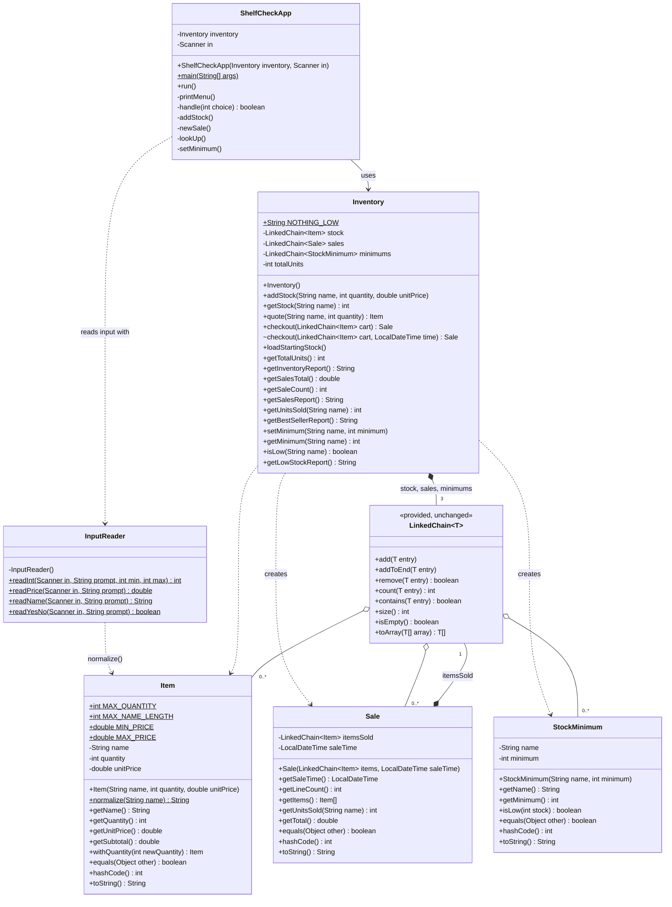

# ShelfCheck – Grocery Stock Tracker

CS 2114 · Project 2 · Deliverable 4 (Final Build) · Group 86
Raul Garuz, Thomas Cherian, Karthik Mittadhoddi

ShelfCheck tracks a small grocery store's stock and sales. The manager adds
shipments, rings up a customer's items as one sale, looks up how much of each
product is on the shelves, and sees total units, revenue and best sellers. Each
product can have a minimum, and ShelfCheck prints an alert after any sale that
drops stock below it.

All data is stored in the course's generic `LinkedChain<T>`, used unchanged for
four element types: `Item`, `Sale`, `StockMinimum` and `String`.

## Project layout

```
LinkedChain.java          provided by CS 2114 staff, unchanged
Project 2- 86/
  Item.java               one shipment (batch): name, quantity, unit price
  Sale.java               one receipt: a LinkedChain<Item> and a time
  StockMinimum.java       a low-stock rule: product name and minimum
  Inventory.java          store rules; holds every LinkedChain
  InputReader.java        reads and validates keyboard input, re-prompts
  ShelfCheckApp.java      text menu and main
  ItemTest.java, SaleTest.java, StockMinimumTest.java, InventoryTest.java,
  InputReaderTest.java, ShelfCheckAppTest.java      JUnit 5 tests
lib/junit.jar             JUnit console launcher (download, see below)
```

## UML class diagram

`ShelfCheckApp` talks to the user through `InputReader` and asks `Inventory`
to do the work. `Inventory` is the only class that holds the store's data, and
every collection in the program is the same provided `LinkedChain`.



`LinkedChain<String>` also appears inside `Inventory`'s report methods, to
remember which product names have already been counted.

## How to compile and run

Run these from the repository folder. Keep each command on **one line**, and
recompile after every `git pull` so you never run an old build.

**Set up JUnit once:** download `junit-platform-console-standalone` (1.9 or
newer) from Maven Central, save it as `lib/junit.jar`.

**Compile everything (program and tests):**

```
javac -d bin -cp lib/junit.jar LinkedChain.java "Project 2- 86"/*.java
```

**Run the program:**

```
java -cp bin ShelfCheckApp
```

**Run the tests** (109 tests, all passing):

```
java -jar lib/junit.jar -cp bin --scan-class-path
```

**In VS Code:** with the Extension Pack for Java installed, open the Testing
panel (flask icon), choose **JUnit Jupiter** if asked, and click **Run All
Tests**. Run the program with the **Run** button above `main` in
`ShelfCheckApp.java`.

## Using ShelfCheck

The store opens with five products and their minimums:

| Product | Units | Price | Minimum |
| --- | --- | --- | --- |
| bananas | 30 | $0.29 | 10 |
| apples | 50 | $0.79 | 10 |
| cheese | 15 | $4.99 | 5 |
| milk | 20 | $3.49 | 5 |
| bread | 25 | $2.99 | 5 |

**Menu:** 1 Add stock · 2 New sale · 3 Look up item · 4 Inventory ·
5 Total units · 6 Sales summary · 7 Best sellers · 8 Low stock ·
9 Set minimum · 0 Quit

Bad input never crashes the program. `InputReader` re-prompts on a wrong
format (“abc” as a quantity, a name with no letters like “3”, a price like
“$3”), and `Inventory` refuses anything that breaks a store rule (selling more
than is in stock, a second price for the same product). Checkout is
all-or-nothing: if any line in the cart fails, nothing is sold.

## Reflection

### What changed from our specification?

| Area | Spec said | We built | Why |
| --- | --- | --- | --- |
| Stock | One `String` per unit | One `Item` per shipment (name, quantity, price) | TA meeting: one node per shipment instead of per unit, and a batch keeps the price with the stock |
| Sale | A sale was one item | `Sale` holds its own `LinkedChain<Item>` and a time | TA meeting: a real receipt lists several items |
| ShelfCheckApp | Only `main` | Constructor `ShelfCheckApp(Inventory, Scanner)` and `run()`; `main` just creates the app and calls `run()` | Lets JUnit drive the whole menu with input from a String instead of a person typing |
| Sale | Copies the cart | Copies it by walking the cart's array backwards with `add()` | `addToEnd()` would make the copy O(k²); this keeps it O(k), as the spec promised |
| Sale | No way to read its lines | Added `getItems()` (returns a copy) | Needed for the best-sellers report |
| Inventory | MVP methods only | Added `getUnitsSold(name)` and `getBestSellerReport()`, plus menu option 7 | Best-sellers stretch goal |
| Inventory | Started empty | Added `loadStartingStock()`, called from `main` | The app opens with products to sell, so a demo doesn't start with typing shipments |
| Item / InputReader | A name only had to be non-blank and at most 30 characters | `Item.normalize` also requires at least one letter, and `InputReader.readName` checks the name right away and re-prompts | We typed “3” as a name and it was accepted; the check also used to run only after quantity and price were entered |
| Low stock | Not in the spec | New `StockMinimum` class in a `LinkedChain<StockMinimum>`; `setMinimum`, `getMinimum`, `isLow`, `getLowStockReport`; menu options 8 and 9; an alert after each checkout | Low-stock stretch goal, and a fourth element type for `LinkedChain` |
| Validation | Menu choice out of range → "Invalid option." | Re-prompts with "Enter a number from 0 to 9." | Same response (re-prompt); one shared message from `InputReader.readInt` |
| New sale | Quote on an empty inventory throws | The app checks for an empty inventory before asking for items | Friendlier; the exception is still in `Inventory.quote` and still tested |
| Tests | Fixed time `t` in the plan | Added a package-private `checkout(cart, time)` | So sale times in tests are repeatable |
| Early prototype | — | An early category prototype (`GroceryInventory`) built its own node classes; we removed it | All storage has to go through `LinkedChain`. We kept its starting-stock idea as `Inventory.loadStartingStock()` |

### What changed in the LinkedChain?

Nothing. We used the provided `LinkedChain.java` unchanged. Our classes only
call `add`, `addToEnd`, `remove(T)`, `count`, `contains`, `size`, `isEmpty` and
`toArray(T[])`. We loop over a chain with `toArray(new Item[chain.size()])`
(O(n)) instead of calling `get(i)` in a loop (O(n²)). `toArray` takes a typed
array because of type erasure: Java can't create `new T[]` inside the generic
class. `add` puts new entries at the front, so cart lines use `addToEnd` to keep
receipts in scan order.

### What happened to our unknowns?

| Unknown from our scope | Status |
| --- | --- |
| How bags and linked lists work together | **Resolved.** `LinkedChain` *is* the bag. Our classes hold `LinkedChain` fields and call its methods. |
| Overriding `equals()` so `contains`/`count`/`remove` work on our objects | **Resolved.** `Item`, `Sale` and `StockMinimum` override `equals` and `hashCode`; `ItemTest.testEqualsAndHashCode`, `SaleTest.testEqualsAnyOrderSameMinute` and `StockMinimumTest.testEqualsAndHashCode` prove it. Because matching uses `equals`, `Item` is immutable: selling 5 from a batch of 24 removes it and adds a batch of 19. |
| Reading input with `Scanner` without crashing | **Resolved.** `InputReader` reads whole lines with `nextLine()` and parses them, catching `NumberFormatException` and re-prompting. Ctrl+D quits with "Goodbye." |
| Selling by weight (`double weight`) | **Not built.** It would change every quantity check from `int` to `double`. |

### Stretch goals

| Stretch goal | Result |
| --- | --- |
| Best sellers | **Done.** Menu 7, built on `Sale.getUnitsSold` |
| Low-stock alerts | **Done.** Menus 8 and 9, plus an alert after every sale |
| Categories (Fruit → Apples → …) | Not built: it would change how every item is stored and looked up |
| Sell by weight | Not built: changes every quantity from `int` to `double` |
| Delivery planner | Not built: needs schedules and dates, unrelated to the MVP |

### What doesn't work / known limits

- Data isn't saved between runs; quitting loses everything.
- A product's price can't change while it's in stock (a second price is refused).
- Names are limited to 30 characters and quantities to 1–1000 per shipment.
- Categories, selling by weight and the delivery planner were not built.

### Testing

109 JUnit 5 tests cover every class except the provided `LinkedChain`:
`ItemTest` (18), `SaleTest` (13), `StockMinimumTest` (7), `InventoryTest` (41),
`InputReaderTest` (12) and `ShelfCheckAppTest` (18). Each method is tested
with normal input, edge cases and bad input. The app and input tests script
the keyboard with `new Scanner(String)` and capture what is printed with
`System.setOut`. We also ran the specification's test plan by hand through the
menu.

## Attribution

<!-- Each member: check your rows and edit them so they are accurate for you. -->

| File | Owner | How it was made |
| --- | --- | --- |
| `LinkedChain.java` | CS 2114 staff | Provided; used unchanged |
| `Item.java`, `ItemTest.java` | Raul Garuz | First draft by Claude from our spec; Raul reviewed, compiled and tested it, and found the “3” name bug |
| `Sale.java`, `SaleTest.java` | Raul Garuz | First draft by Claude from our spec; Raul reviewed, compiled and tested it |
| `Inventory.java`, `InventoryTest.java` | Thomas Cherian | First draft by Claude from our spec; Thomas reviewed, compiled and tested it |
| `StockMinimum.java`, `StockMinimumTest.java` | Thomas Cherian | First draft by Claude; Thomas reviewed, compiled and tested it |
| `InputReader.java`, `InputReaderTest.java` | Karthik Mittadhoddi | First draft by Claude from our spec; Karthik reviewed, compiled and tested it |
| `ShelfCheckApp.java`, `ShelfCheckAppTest.java` | Karthik Mittadhoddi | First draft by Claude from our spec; Karthik reviewed, compiled and tested it |
| `README.md` | Raul Garuz | First draft by Claude; edited by the team |

### How we used GenAI

We used Claude (Anthropic) throughout the project. We gave it our scope,
our specification, our TA meeting notes and the provided `LinkedChain.java`.
It reviewed our scope and spec against the rubric, drafted the classes, the
JUnit tests and this README from our spec's signatures and test plan, and
explained Java details we asked about. It also pointed out that our early
`GroceryInventory` prototype bypassed `LinkedChain`.

The design decisions (Item batches, Sale with its own chain, which stretch
goals to build) came from us and our TA. We compiled and ran everything
ourselves, typed bad input by hand, and found the “3” name bug that way. When
Claude's fix seemed not to work, the real cause was that we were running an old
build; we recompiled, moved the check into `readName`, and added
`ItemTest.testNormalizeNeedsALetter`.
